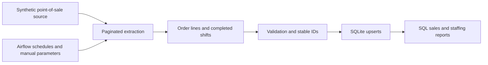

# Aurora Café Analytics — Airflow Portfolio Project

A fictional café reporting pipeline inspired by hands-on Airflow orchestration work. It demonstrates scheduled ingestion, selective backfills, order-line transformation, and completed-shift processing using entirely synthetic data.

**Portfolio status:** this is a reconstructed demonstration. Aurora Café, all records, and all configuration values are fictional. There are no real API keys, customer records, business identifiers, contact addresses, or production endpoints in this project. The demo makes no network requests.

## Business scenario

Aurora Café needs daily sales and staffing reports without manually exporting point-of-sale data. Its fictional operations team also needs to replay historical dates and refresh individual entities when records arrive late.

The architecture is modeled on a point-of-sale-to-cloud-warehouse workflow. This implementation substitutes a paginated mock source and SQLite so a reviewer can run it without accounts or credentials. Live Square and Supabase integrations are design context; they are not implemented in this demo.

## Architecture



| DAG | Behavior |
| --- | --- |
| `aurora_daily_sales` | Runs at 18:00 America/Edmonton; loads the previous completed calendar day. Dimensions run before payments and order lines. |
| `aurora_manual_backfill` | Accepts inclusive start/end dates and either all six sales entities or one selected entity. Supports dry runs. |
| `aurora_orders_only` | Replays only order lines for an inclusive date range. Equal dates provide a single-day replay. |
| `aurora_daily_shifts` | Reloads seven completed calendar days to demonstrate handling late shift updates. Skips open shifts. |

Daily tasks derive their dates from Airflow's logical interval boundary. Retrying an old run selects the same business date. Windows use local midnight converted to UTC and an exclusive end, including daylight-saving days. All loaders raise failures so Airflow can retry.

## Run the offline demo

Use Python 3.10 or 3.11. No additional packages are required for the offline pipeline.

```bash
python3 scripts/run_demo.py
python3 scripts/run_demo.py  # repeat to demonstrate idempotent writes
python3 scripts/run_demo.py --entity orders --start-date 2025-03-09 --end-date 2025-03-09
python3 scripts/run_demo.py --entity shifts --dry-run
python3 -m unittest discover -s tests -v
```

The default run covers March 8–10, 2025, including the spring daylight-saving transition. It produces one customer, loyalty account, category, and product; three payments; three order lines; and three completed shifts. Open shifts are excluded. Repeating the same range keeps table counts stable.

Generated databases go to `output/` and are excluded by `.gitignore`. Airflow tasks default to `/tmp/aurora-demo/warehouse.sqlite`; set `DEMO_WAREHOUSE_PATH` to change that location. Use a shared path if running tasks on multiple workers; this local demo assumes one machine.

Run reporting queries with Python:

```bash
python3 - <<'PY'
import sqlite3
from pathlib import Path
with sqlite3.connect('output/warehouse.sqlite') as connection:
    for query in Path('sql/analytics.sql').read_text().split(';'):
        if query.strip():
            print(connection.execute(query).fetchall())
PY
```

Each demo day has one completed order, two items sold, CAD 11.00 in sales including tax, and 7.5 paid staff hours. These are synthetic outputs, not business performance claims.

## Run in Airflow

The DAGs target **Airflow 2.10.5**, matching the Airflow 2 operator style of the source work. This is a reproducible portfolio compatibility target. Airflow 3 migration has not been implemented.

From this project directory, use a separate Python 3.11 virtual environment and the official constraints file:

```bash
python3.11 -m venv .venv
source .venv/bin/activate
pip install -r requirements-airflow.txt --constraint https://raw.githubusercontent.com/apache/airflow/constraints-2.10.5/constraints-3.11.txt
export AIRFLOW_HOME="$PWD/.airflow"
export AIRFLOW__CORE__DAGS_FOLDER="$PWD/dags"
export AIRFLOW__CORE__LOAD_EXAMPLES=False
export PYTHONPATH="$PWD/dags${PYTHONPATH:+:$PYTHONPATH}"
export DEMO_WAREHOUSE_PATH="$PWD/output/airflow-warehouse.sqlite"
airflow standalone
```

Open the local UI shown by Airflow, enable the daily DAGs, or trigger `aurora_manual_backfill` with its parameter form. Airflow generates local login credentials at startup; they are not included in this portfolio. To check DAG imports in this environment, run `python -m unittest discover -s tests -v`.

Installation reference: [Apache Airflow 2.10.5 documentation](https://airflow.apache.org/docs/apache-airflow/2.10.5/installation/installing-from-pypi.html).

## Configuration and privacy

`.env.example` contains deliberately fake API tokens and a reserved `.invalid` endpoint. These values illustrate a future adapter configuration only; the mock source ignores them. The demo reads `DEMO_WAREHOUSE_PATH` from the process environment and does not automatically load `.env` files. Its business timezone is fixed in code.

No original DAGs, environment files, databases, logs, or credential values were copied. Keep local `.env` files and generated artifacts excluded when publishing. Do not insert real credentials into README examples, code, screenshots, or commit history.

## Project layout

```text
dags/aurora_dags.py              Four Airflow DAG definitions
dags/aurora_pipeline/pipeline.py Mock source, date windows, transforms, warehouse
dags/aurora_pipeline/tasks.py    Reusable Airflow callables
scripts/run_demo.py              Offline command-line entry point
sql/analytics.sql               Sales and paid-hours reports
tests/                          Pipeline tests and optional DAG import test
docs/CASE_STUDY.md               Portfolio narrative and design tradeoffs
docs/VALIDATION.md               Actual checks and their limitations
.env.example                    Fictional configuration placeholders
```

## Engineering decisions

- Stable primary keys and upserts allow safe date replays. Order-line keys combine the order ID and line UID.
- Pagination and seven-day chunks keep extraction bounded in the demonstrated workload.
- Integer cents avoid floating-point currency transformations.
- Small count summaries go through XCom; source records stay in the warehouse.
- Dry runs perform extraction and transformation without opening a database.
- Branch joins use `none_failed_min_one_success` so deliberately skipped entities do not block completion.
- Retries, execution timeouts, and one active run per DAG bound operational behavior.

SQLite payload tables make this demo portable. A production adaptation would need real adapters, normalized tables and foreign keys, deletion handling, incremental watermarks, API throttling, schema-change monitoring, and a configured failure notification channel. Manual entity loads are independent in this payload-based demo; a warehouse with foreign keys would require dependency-aware backfills.
